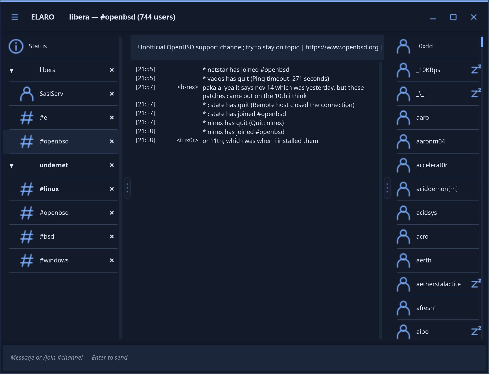

# Elaro — An Enlightened IRC Client

I love [Irssi](https://irssi.org/). I've chosen it as Elaro's engine because
I trust it to do the IRC work. Elaro brings that familiar foundation to a
desktop interface built with Enlightenment's EFL.

Like Evisum, the interface reflects my own preferences and affection for
Enlightenment. I wanted somewhere comfortable to chat, with channels, people
and conversations close at hand. Most of the controls should explain themselves.
I hope you enjoy using it.

## Artificial Intelligence

This program was written 100% with Codex 6.1 with prompts and testing by the
copyright holder. It's a very contentious subject but having solved every
problem in the program before manually and knowing how long it would take
there seems to be no sense in not using AI.

AI is the democraticisation of intelligence. You're clever? That's a genetic
advantage you *had* over the general public. Now with AI anyone can implement
anything and we can't go around pretending we're more important than other
users because "we're developers." LLMs are here to stay.



## Features

- Chat on several IRC networks, with saved connection profiles.
- Optionally reconnect after a connection drops and rejoin your channels.
- Keep channels and private conversations close at hand.
- See which conversations have unread messages.
- Spot unread mentions of your nickname with amber highlights in the conversation list.
- See the current channel’s user count beside its name in the top bar.
- Get optional desktop notifications for private chats you aren't viewing.
- Share files directly with other people.
- Preview image links and listen to linked audio without leaving the chat.
- See Gravatar avatars for people who share a public email.
- Edit channel topics and manage users from the user list.
- Complete nicknames with Tab and recall sent messages with Up and Down.
- Use familiar IRC commands alongside the graphical controls.
- Choose Midnight, Porcelain, Verdigris, or Ember, with matching widgets and icons.
- Use client-side window borders with drag, resize, minimize, and maximize controls.
- Adjust window transparency to suit your desktop.
- Keep your window position, size and panel widths between starts.

## Getting started

Open the top-left application menu and choose **Settings** to add
and save a connection, then select it and choose
**Connect**. You can save several connections for the networks you use.
TLS is enabled by default, and SASL authentication is available when needed.
Each connection has an **Automatically reconnect and rejoin channels** checkbox.
When enabled, Elaro retries after five seconds, up to five times, with a
30-second timeout for each attempt. Your existing chats and history stay in place.
Closing the server or using `/quit` cancels automatic reconnects.
Use `/quit Gone fishing` to send a custom quit message when disconnecting from
the current server; `/quit` on its own sends `Leaving`.
Closing a server disconnects it and closes all of its channels and private chats.

The application menu shows all four themes under **Appearance**: Midnight,
Porcelain, Verdigris, and Ember. Click a theme to apply and save it immediately;
the current choice is highlighted. The menu also contains **About Elaro** and **Quit**.
About has artwork for the current theme and separate **Overview**, **Credits**,
and **License** pages.

Drag the Elaro title to move the window, double-click it to maximize or restore,
and drag any edge or corner to resize. The clear header areas are draggable;
the menu, channel heading, and window buttons retain their own actions.
Settings and About share the same tab strip. Popups fade and slide into view,
fade out on dismissal, and fade between tab pages. Close popups using the icon
in the top-right corner. Panel dividers have matching themed grips you can drag
to resize the sidebars. Chat colors and inline metadata follow the selected
theme through history refreshes and toolkit appearance changes.
Each theme has its own source in `data/themes/<name>/<name>.edc`, compiled into
an independently installed EDJ. The shared `widgets.edc` defines widget contracts;
each theme supplies its palette and SVG icons.

The left sidebar groups channels and private conversations beneath each server.
Use the arrow beside a server to expand or collapse its conversations. Collapsing
keeps your active chat, history and drafts intact. Unread conversations and
their server appear in bold. Channels use a speech-bubble icon and private
conversations use a person icon. Opening a conversation reveals it automatically.

Join a channel with `/join #channel`, or click a person's name to start a
private conversation. Right-click a name for more actions. Familiar IRC
commands work in the message entry, including `/me waves` to send an action
in a channel or private conversation. Tab completes nicknames, and Up and Down
recall your sent messages and commands separately for each conversation.
Joins, departures, quits and nickname changes appear as readable chat events.
Click the channel heading to view its current ban masks. Select a mask and choose
**Unban selected mask** to remove it (channel operator privileges may be required).
Use **Refresh** to fetch the latest list.

Type `/list` in a server or conversation, or right-click a server in the left
sidebar and choose **List channels**, to open that server’s channel browser.
Channels are sorted alphanumerically and show their user counts and topics.
Select a channel and click **Join selected channel** to join it, or use **Refresh**
to fetch the list again. Large lists load in the background so you can keep chatting.

Use Irssi’s standard `/mode` syntax to query or change channel modes:
`/mode #channel` shows the current modes, `/mode +nt` changes the current
channel, and `/mode #channel +o nick` gives a user operator status.
You can also use `*` for the current channel, such as `/mode * +l 50`.
Mode changes require the appropriate privileges on the server.

You can share files, preview image links and listen to linked audio without
leaving the conversation. The **Options** tab in Settings groups preferences
for links, notifications and window appearance.
Enable **Notify about private messages** there
to receive desktop notifications for private conversations that are not selected.
Notifications use the Elaro icon and require `notify-send`.
Turn on **Enable sounds** to play the ICQ sound for private conversations that
are not selected. Sounds are off by default and work independently of desktop
notifications.

Away users show a sleeping-person indicator at the right of their user-list
row, alongside their usual operator, voice or user icon on the left. Private
conversations also use the sleeping-person icon while the user is away. Elaro uses the server's WHO/WHOIS replies and IRCv3 `away-notify`
updates. Live away/back updates require server support for `away-notify`;
otherwise the state refreshes when WHO or WHOIS replies arrive.

Use `/away Out for lunch` to set your away message and `/away` to mark yourself
back. As in Irssi, this applies to all connected servers. Add `-one` to affect
only the current server: `/away -one Out for lunch` or `/away -one` to return.

You can optionally add a public email to a connection profile for Gravatar.
It is shared in your IRC real name as `Name <email>`; leave it blank to keep
your email private. Hover over a nickname in the user list to see their avatar
when they share an email this way. Avatars are fetched from Gravatar on hover
and cached locally, including missing-avatar responses. Profile changes take
effect when you reconnect.

## Building and installing

You'll need EFL/Elementary 1.26 or newer, GLib, OpenSSL, and the usual C build
tools, including Meson and Ninja. Python 3 is needed for the tests.

```sh
meson setup build
ninja -C build
./build/src/fe-efl/elaro
```

To install the application and its desktop menu entry:

```sh
meson install -C build
```

Elaro stores its desktop and embedded IRC engine settings in `~/.config/elaro`.

To run the tests:

```sh
meson test -C build --print-errorlogs
```

## Thanks

Thank you to the Irssi authors and contributors for an IRC client I love and
an engine I trust, and to the EFL and Enlightenment community for the toolkit
and desktop that make Elaro feel at home. The Gravatar lookup follows EDI’s approach.

Bug reports, fixes and translations are welcome.

Elaro is based on the Irssi IRC engine and retains its original authorship
and copyright notices. Licensed under GPL-2.0-or-later; see [COPYING](COPYING)
and [AUTHORS](AUTHORS).
